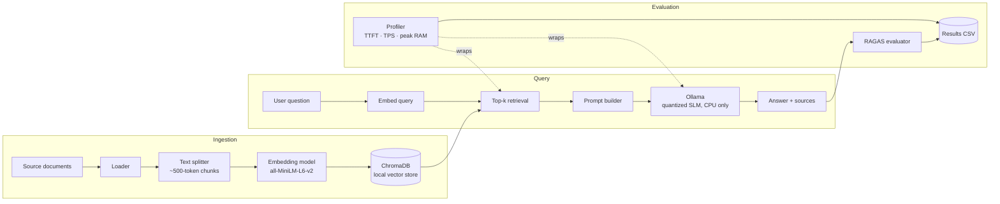

# Local-Rag-Pipeline

**Local RAG on Consumer CPUs: A Feasibility and Benchmarking Study**

Final Year Project (BSc Software Development for AI and Cloud Computing).
**Author:** Seán Bardon · **Supervisor:** Roger Young · **Submission:** April 2027

## Overview

Retrieval-Augmented Generation (RAG) usually depends on cloud LLM APIs or a dedicated GPU. Both cost money and raise privacy concerns. This project looks at whether **quantized Small Language Models (SLMs)** running **only on a consumer CPU** can deliver acceptable RAG performance with no cost and with no data leaving the machine.

It delivers:

1. **A fully local RAG pipeline.** Document ingestion, vector storage and model inference all run on one machine using open-source tools.
2. **An automated benchmarking suite.** It measures hardware cost (time to first token, tokens per second, peak RAM) and answer quality (Faithfulness, Answer Relevancy, Context Precision) for each model and quantization level.
3. **A decision matrix.** It sets out the trade-off between quantization level, speed, memory and accuracy.

### Research question

> Can 4-bit and 8-bit quantized SLMs deliver acceptable RAG accuracy and responsiveness on CPU-only consumer hardware, and how does quantization level trade off speed and memory against answer quality?

## Architecture



| Component | Technology | Why it was chosen |
|---|---|---|
| Orchestration | LangChain | Widely used RAG framework with integrations for every other component |
| Vector store | ChromaDB | Lightweight, embedded and runs locally without a server |
| Embeddings | all-MiniLM-L6-v2 | Small (~80 MB), fast on CPU, strong retrieval baseline |
| Inference | Ollama (llama.cpp / GGUF) | Simple local serving of quantized models |
| Models under test | Llama 3.2 3B, Phi-4-mini | Modern models small enough for 16 GB RAM |
| Quantization | Q4_K_M, Q8_0 | Common 4-bit and 8-bit GGUF formats |
| Evaluation | RAGAS | Reproducible, automated accuracy metrics |
| Profiling | psutil, time.perf_counter | Low-overhead RAM and latency measurement |

## Repository structure

```
├── configs/            # YAML experiment configs (model, quantization, chunking, top-k)
├── data/
│   ├── raw/            # Source documents (downloaded, not committed)
│   ├── processed/      # Intermediate artefacts (not committed)
│   └── eval/           # Evaluation question set with reference answers (committed)
├── docs/diagrams/      # UML and architecture diagrams
├── results/            # Benchmark run logs (raw runs not committed)
├── scripts/            # Command-line entry points (ingest, query, benchmark)
├── src/local_rag_pipeline/
│   ├── ingest/         # Loading, chunking, embedding, storage
│   ├── retrieval/      # Vector search
│   ├── generation/     # Prompting and Ollama inference
│   ├── benchmark/      # Hardware and latency profiling
│   └── evaluation/     # RAGAS accuracy scoring
└── tests/              # Unit and functional tests (pytest)
```

## Getting started

**Requirements:** Python 3.11, [Ollama](https://ollama.com), Git.

```bash
git clone <repo-url>
cd Local-Rag-Pipeline

python -m venv .venv
# Windows: .venv\Scripts\Activate.ps1   |   macOS/Linux: source .venv/bin/activate
pip install -e ".[dev]"

ollama pull llama3.2:3b
```

Usage instructions will be added as each pipeline stage is completed.

## Test environment

All benchmarks run CPU-only. GPU offload is turned off (`num_gpu: 0`) so results reflect hardware with no GPU.

| Machine | CPU | RAM | GPU (disabled for benchmarks) |
|---|---|---|---|
| Desktop | AMD Ryzen 5 3600 (6C/12T, 3.6 GHz) | 16 GB DDR4-2400 | GTX 1050 Ti 4 GB |
| Laptop | AMD Ryzen 3 5425U (4C/8T, 2.7 GHz) | 8 GB DDR4-3200 | Integrated Radeon (shared memory) |

The two machines represent two hardware tiers: a mid-range desktop with 16 GB of RAM and an entry-level laptop with 8 GB.

## Development workflow

- `main` holds stable, demo-ready code only. It is protected, and changes reach it only through pull requests.
- `develop` is the integration branch.
- `feature/<name>` branches hold individual pieces of work and are merged into `develop` through pull requests.
- Milestones are tagged on `main` (for example `v0.1-demo1`).
- Commit messages follow [Conventional Commits](https://www.conventionalcommits.org) (`feat:`, `fix:`, `docs:`, `test:`, `chore:`).

## Project status

- [x] Repository scaffolding
- [ ] CPU-only inference proof of concept
- [ ] Ingestion pipeline (chunking, embedding, ChromaDB)
- [ ] Retrieval and generation chain
- [ ] Profiling harness (TTFT, TPS, peak RAM)
- [ ] Evaluation dataset with reference answers
- [ ] RAGAS accuracy evaluation
- [ ] Benchmark runs across all model/quantization configurations
- [ ] Analysis and decision matrix

## Key references

[1] P. Lewis et al., "Retrieval-Augmented Generation for Knowledge-Intensive NLP Tasks," in *Proc. NeurIPS*, 2020, arXiv:2005.11401.
[2] S. Es, J. James, L. Espinosa-Anke, and S. Schockaert, "RAGAS: Automated Evaluation of Retrieval Augmented Generation," 2023, arXiv:2309.15217.
[3] Microsoft, "Phi-4-Mini Technical Report: Compact yet Powerful Multimodal Language Models via Mixture-of-LoRAs," 2025, arXiv:2503.01743.
[4] Meta, "Llama 3.2 Model Card," Hugging Face, 2024.
